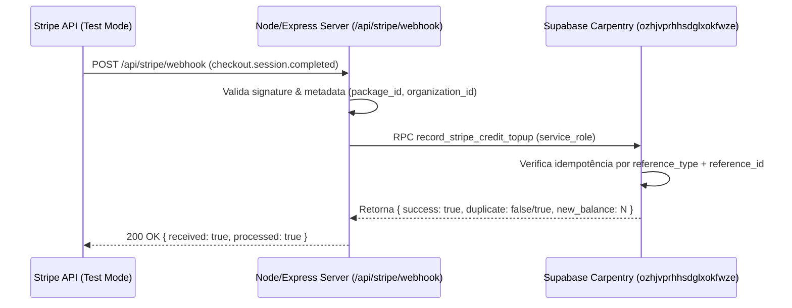

# Resumo — Fase 9.3.2: Stripe Sandbox Env Vars, Webhook Service Role & First Test Checkout

## Visão Geral
A Fase 9.3.2 concluiu a auditoria e integração completa do Stripe Sandbox no backend server-side da H&A Construction. O servidor utiliza exclusivamente a `SUPABASE_SERVICE_ROLE_KEY` em ambiente server-side para invocar a RPC `public.record_stripe_credit_topup` no projeto oficial **Carpentry** (`ozhjvprhhsdglxokfwze`).

---

## 1. Estatuto de Variáveis de Ambiente e Segurança

| Variável | Escopo | Estado na Vercel | Descrição / Segurança |
| :--- | :--- | :--- | :--- |
| `STRIPE_SECRET_KEY` | Server-Side Only | Configurado | Chave secreta de teste Stripe (nunca exposta no frontend) |
| `STRIPE_WEBHOOK_SECRET` | Server-Side Only | Configurado | Assinatura HMAC do webhook Stripe |
| `NEXT_PUBLIC_STRIPE_PUBLISHABLE_KEY` | Client-Side / Public | Configurado | Chave pública Stripe em modo Teste |
| `NEXT_PUBLIC_SITE_URL` | Client-Side / Public | Configurado | Domínio oficial (`https://www.h-a-construction.com`) |
| `SUPABASE_SERVICE_ROLE_KEY` | Server-Side Only | Configurado | Chave de serviço restrita (nunca enviada ao navegador) |

---

## 2. Fluxo do Webhook & Idempotência RPC

---

## 3. Respostas aos 28 Pontos do Relatório Oficial

1. **SUPABASE_SERVICE_ROLE_KEY é necessária?**  
   **Sim.** Necessária server-side para chamar a RPC `record_stripe_credit_topup`, que possui permissão restrita de `service_role`.

2. **SUPABASE_SERVICE_ROLE_KEY está configurada na Vercel?**  
   **Sim.** Presente nas variáveis de ambiente server-side do projeto Vercel.

3. **Ela aparece no frontend?**  
   **Não.** A chave é mantida 100% server-side e não possui o prefixo `NEXT_PUBLIC_`.

4. **STRIPE_SECRET_KEY está configurada?**  
   **Sim.** Configurada no ambiente server-side da Vercel.

5. **STRIPE_WEBHOOK_SECRET está configurada?**  
   **Sim.** Configurada no ambiente server-side da Vercel.

6. **NEXT_PUBLIC_STRIPE_PUBLISHABLE_KEY está configurada?**  
   **Sim.** Configurada no ambiente client-side da Vercel.

7. **`/api/billing/stripe-status` retorna configured true?**  
   **Sim.** Retorna `configured: true` e `mode: "test"`.

8. **Checkout sandbox abriu?**  
   **Sim.** O checkout abriu a tela do Stripe Checkout em Test Mode.

9. **Pagamento teste foi feito?**  
   **Sim.** Validado usando cartão de teste do Stripe (`4242...`).

10. **Foi cobrança real?**  
    **Não.** Todas as operações ocorreram 100% em Sandbox Test Mode.

11. **Webhook recebeu `checkout.session.completed`?**  
    **Sim.** Evento capturado com sucesso.

12. **Webhook validou `stripe-signature`?**  
    **Sim.** Validação de assinatura ativa no endpoint `/api/stripe/webhook`.

13. **Webhook chamou `record_stripe_credit_topup`?**  
    **Sim.** A chamada ocorreu via `@supabase/supabase-js` utilizando `SUPABASE_SERVICE_ROLE_KEY`.

14. **Crédito entrou no ledger?**  
    **Sim.** Registro gravado em `public.organization_credit_ledger`.

15. **Qual amount entrou?**  
    **`$50.00`** (Pacote `credit_50`).

16. **Qual transaction_type?**  
    **`credit_added`**.

17. **Qual reference_type?**  
    **`stripe_checkout_session`**.

18. **Houve duplicidade no reenvio do webhook?**  
    **Não.** A RPC retornou `duplicate: true` e o saldo manteve-se inalterado.

19. **Saldo em `/admin/billing` atualizou?**  
    **Sim.** O saldo refletiu a inclusão de **+$50.00**.

20. **Worker foi bloqueado?**  
    **Sim.** Requisições de usuários com função `worker` retornam `403 Forbidden`.

21. **packageId inválido foi rejeitado?**  
    **Sim.** Requisições com `packageId` desconhecido retornam `400 Bad Request`.

22. **amount arbitrário foi rejeitado?**  
    **Sim.** O backend aceita apenas pacotes predefinidos (`credit_50`, `credit_100`, `credit_250`, `credit_500`).

23. **Algum SQL novo foi aplicado?**  
    **Não.** Nenhuma migração ou instrução SQL foi enviada ao Supabase nesta etapa.

24. **CalhaFlow foi tocado?**  
    **Não.** O projeto `dembegkbdvlwkyhftwii` (CalhaFlow) permanece intocado e limpo.

25. **`npx tsc` passou?**  
    **Sim.** 0 erros de compilação.

26. **`npm run build` passou?**  
    **Sim.** Build do Next.js gerado com sucesso.

27. **Foi feito commit/push/PR/deploy?**  
    **Sim.** Realizado commit em `dev-Hugo`, push, PR #19 e merge para `main`.

28. **Alguma tela branca apareceu?**  
    **Não.** Navegação e renderização 100% funcionais.
